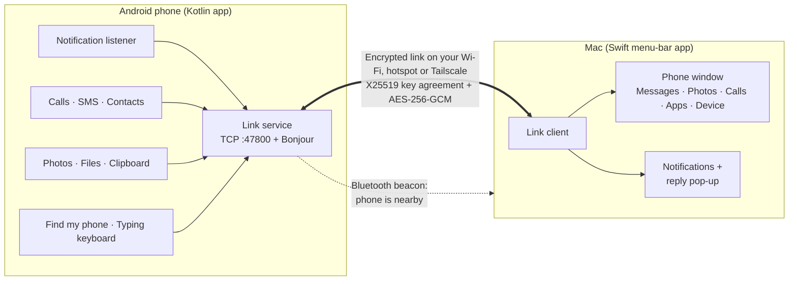
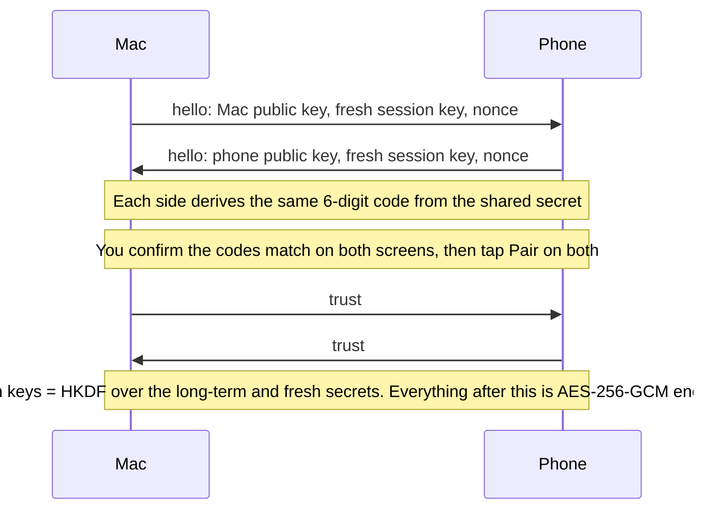

<p align="center">
  
</p>

<h1 align="center">PhoneBridge</h1>

<p align="center">
  <b>Your Android phone, built into your Mac.</b><br>
  Calls, messages, notifications, files, clipboard and more, in one free, open-source app.<br>
  No account, no cloud, no servers. Everything stays between your own two devices.
</p>

<p align="center">
  <a href="https://github.com/Abhinavchitturi/PhoneBridge/releases/latest"></a>
  
  
  <a href="LICENSE"></a>
</p>

## ⬇️ Download

| Device | Download | Requires |
|---|---|---|
| 💻 **Mac** | [**PhoneBridge.dmg**](https://github.com/Abhinavchitturi/PhoneBridge/releases/latest/download/PhoneBridge.dmg) | macOS 15 or later |
| 📱 **Android phone** | [**PhoneBridge.apk**](https://github.com/Abhinavchitturi/PhoneBridge/releases/latest/download/PhoneBridge.apk) | Android 13 or later |

You need **both**: the Mac app and the phone app. Install them, then pair them once ([steps below](#-get-started-in-3-steps)). Older versions and each file's SHA-256 are on the [Releases page](https://github.com/Abhinavchitturi/PhoneBridge/releases).

> 🪟 **Windows (preview):** a Windows app is in [`windows/`](windows), with the same design and features as the Mac app (see [`windows/README.md`](windows/README.md)). Once a release includes `PhoneBridge-Windows.exe` it's a one-file download that keeps itself up to date; until then, [build it yourself](#windows-app-preview).

---

## 🚀 Get started in 3 steps

### 1. Install on your Mac
1. Open **PhoneBridge.dmg** and drag **PhoneBridge** into **Applications**.
2. Open it. The first time, macOS says **"PhoneBridge" Not Opened: Apple could not verify "PhoneBridge" is free of malware**. That's because PhoneBridge is a free app that isn't registered with Apple, not because anything is wrong with it. Click **Done** (not Move to Trash), then allow it once:
   - Open **System Settings → Privacy & Security** and scroll to the bottom.
   - Next to **"PhoneBridge" was blocked to protect your Mac**, click **Open Anyway**, enter your Mac password, then click **Open Anyway** again.

   Or skip all that by running this once in Terminal, then opening PhoneBridge again:
   ```bash
   xattr -dr com.apple.quarantine /Applications/PhoneBridge.app
   ```
   You only do this once. Later versions install themselves through **Update Now**, without this warning.
3. PhoneBridge lives in the **menu bar**. Allow **Notifications** and **Local Network** when macOS asks. Other permissions are requested only when you turn on the feature that needs them.

### 2. Install on your phone
1. Download **PhoneBridge.apk** on the phone (or send it over from the Mac) and open it. Allow installs from that source when Android asks.
2. If Google Play Protect warns about an app from outside the Play Store, tap **More details → Install anyway**. On Samsung phones, turn **Auto Blocker** off just while installing.
3. Open **PhoneBridge** and follow the setup card: allow **Calls**, **SMS**, **Notifications**, **Photos** and **notification access**, and let it **run in the background**. Every permission is optional. Skip any feature you don't want, and if you'd rather not share texts at all, turn off **Settings → SMS on Mac**. If a switch is greyed out, see [Allowing SMS, calls and notifications](#allowing-sms-calls-and-notifications-restricted-settings).

### 3. Pair them
Open PhoneBridge on both devices on the same Wi-Fi (a phone hotspot works too). They find each other and both show the same **6-digit code**. If the codes match, tap **Pair** on both. You only do this once.

**More than one computer?** One phone can be paired with several computers and uses one at a time. On the phone, open **Settings → Computers** (or tap the computer's name on Home) → **Pair a new computer** to add another, and tap **Connect** next to any paired computer to switch to it. Rename and Forget are there too.

---

## ✨ Features

### 📞 Calls and messages
- **Calls on your Mac:** see who's calling, **Answer** or **Decline** from the Mac, then **Mute**, **Speaker** or **End** from an in-call card with a timer. The voice stays on the phone.
- **Notifications on your Mac:** reply right from a pop-up with a ready text box. Dismiss on one device and it's dismissed on the other.
- **Smart replies:** three suggested replies on chat notifications, written on-device by Apple Intelligence. Nothing leaves your Mac. Needs a Mac with Apple Intelligence turned on.
- **Messages, call history and notification history**, searchable from the Mac.
- **Login codes:** one-time codes from texts go straight to your Mac's clipboard, kept out of clipboard history and wiped after 60 seconds.
- **Missed-call auto-reply:** the phone can text back *"I'm busy, I'll call you back"* for you.
- **SMS on Mac switch:** rather keep your texts off the Mac? Turn off one switch on the phone and PhoneBridge stops reading and sending SMS entirely. Calls and everything else keep working.

### 📁 Files, photos and clipboard
- **Send files both ways** in one click, or drop files on the menu bar icon.
- **Photos and videos** from the phone, with drag-and-drop into Finder.
- **Shared clipboard** with history: Mac → phone automatically, phone → Mac with **Share → Send to Mac** or the quick-settings tile.
- **Shared notepad** that syncs as you type, on both devices.
- **Screenshots:** phone screenshots arrive on the Mac automatically, and new Mac screenshots can go to the phone.
- **Scan to Mac:** scan a document with the phone's camera, crop and clean it up, and it lands on your Mac.

### 💻 Your phone, on your Mac
- **Phone apps in their own windows:** open any app from the phone in a window on your Mac and use it with your mouse and keyboard.
- **Type from Mac:** type on your Mac keyboard into any text box on the phone (switch on the **PhoneBridge keyboard** on the phone first).
- **Phone as a microphone** for Zoom, Meet or Teams on the Mac (uses the free [BlackHole](https://github.com/ExistentialAudio/BlackHole) virtual audio device).

### 📱 Your Mac, from your phone
- **Trackpad and keyboard:** use the phone as a trackpad (one finger to move, tap to click, two fingers to scroll) or as a keyboard for the Mac. It follows your Mac's own trackpad settings (natural scrolling, tracking speed, swipe gestures).
- **Three-finger gestures:** swipe left or right to switch full-screen apps and desktops, up for Mission Control, down for App Exposé. Tap with three fingers, then tap-hold and drag up or down to zoom in or out on the Mac.
- **Full keyboard in landscape:** turn the phone sideways on the Keyboard tab for a full Mac keyboard with ⌘, ⌥, ⌃, ⇧, numbers and arrows, so shortcuts like ⌘C or ⌘Tab work.
- **Video controls:** when a video is in front on the Mac (Netflix, YouTube, VLC, QuickTime…), Home shows −10 s, +10 s, Esc and Full screen.
- **Mac's tab:** open the page you were viewing in your Mac's browser on the phone, so you can carry on as you leave.
- **Remote controls:** lock or sleep the Mac, control its music and volume, and run any of your Mac **Shortcuts**.
- **Find Mac:** play a sound on the Mac to find it.
- **Automatic updates:** both apps check for a new version and offer **Update now**. One tap downloads it, installs it and reopens PhoneBridge. (On the phone, Android asks once to allow PhoneBridge to install updates.)

### 🔋 Device and security
- **Battery** with charging status and time until full.
- **Find my phone:** ring it, vibrate it, or see it on a map and open it in Maps.
- **Quick controls:** flashlight, Do Not Disturb and ringer mode.
- **Lock when you walk away:** the Mac locks when your phone leaves the room and wakes when it comes back. Switch it off or change the distance in Settings.
- **Away from home:** with [Tailscale](https://tailscale.com) (free) on both devices, PhoneBridge reconnects even when they aren't on the same Wi-Fi.

### 🎨 Themes
A clean, minimal dark look with six themes to choose from: **Midnight, Batman, Spider-Man, Iron Man, Thor** and **Matrix**. Each has its own artwork and animations. Pick a theme on either device and the other switches too.

---

## 🔒 Privacy and security

PhoneBridge is designed so your data never leaves your own devices.

- **No account, no cloud, no analytics, no ads.** Your phone and Mac talk to each other directly. There are no PhoneBridge servers.
- **End-to-end encrypted.** After pairing, everything is encrypted with AES-256-GCM, using keys from an X25519 key agreement. Every connection uses fresh keys, so a stolen long-term key can't decrypt past sessions (forward secrecy).
- **You verify the pairing.** The matching 6-digit code on both screens protects against anyone connecting in between. After pairing, the Mac talks only to its phone, and the phone only to the computers in its list; anything else is refused. A phone accepts a new computer only while you have **Pair a new computer** open.
- **Keys are stored securely:** in the Keychain on the Mac, and sealed with an Android Keystore key on the phone (hardware-backed where available).
- **You decide about your texts.** The **SMS on Mac** switch (phone: **Settings → SMS on Mac**) turns off everything that touches SMS: the Messages tab, sending from the Mac, login codes and the missed-call auto-reply. Android then stops waking PhoneBridge for new texts at all. Only the phone can switch it back on, and it can also take away the SMS permission for you.
- **Every permission is optional.** Skip any you don't want and use everything else.
- **Open source and testable.** The protocol is in [`mac/Sources/Crypto.swift`](mac/Sources/Crypto.swift) and [`android/app/src/main/java/app/phonebridge/Crypto.kt`](android/app/src/main/java/app/phonebridge/Crypto.kt), with unit tests that check both sides derive identical keys and codes.
- **One third-party component:** Scan to Mac uses Google's on-device document scanner from Google Play Services.

**Limits:** PhoneBridge has not had an independent security audit, and it can't protect you if the phone or the Mac is already compromised. "Lock when you walk away" is a convenience, not a vault, so also use FileVault and Find My. To report a security issue, see [SECURITY.md](SECURITY.md).

---

## 🛠️ Troubleshooting

### Allowing SMS, calls and notifications ("restricted settings")
Android 13 and later block some permissions, such as **SMS, call log and notification access**, for apps installed outside the Play Store. The switches may look greyed out or say *"App was denied access"*. This is an Android safeguard, not a bug, and it doesn't need root.

1. Open **Settings → Apps → PhoneBridge**.
2. Tap **⋮** (top right) → **Allow restricted settings**. If you don't see ⋮, try granting the permission once so Android registers the block, then come back.
3. Return to PhoneBridge and tap the permission again. It can now be granted.

PhoneBridge uses these permissions only for what they say: SMS for the Messages tab and the missed-call auto-reply; call log, contacts and phone state to show who's calling; notification access to mirror and reply to notifications.

### The devices don't find each other
- Make sure both are on the **same Wi-Fi network**, or that the Mac is on the phone's hotspot.
- Allow **Local Network** for PhoneBridge on the Mac: **System Settings → Privacy & Security → Local Network**.
- Some public and office networks block devices from seeing each other. Use the phone's hotspot or [Tailscale](https://tailscale.com) instead.
- Tap **Search again** on the Mac.

### Phone apps open as a mirrored screen instead of separate windows
Separate app windows need a one-time setup on Wi-Fi. On the Mac, go to **Settings → Phone apps & screen → One-time setup**. It uses `adb` and `scrcpy`:
```bash
brew install --cask android-platform-tools
```
```bash
brew install scrcpy
```

---

## ⌨️ Command line and Shortcuts

While PhoneBridge is running, it keeps a small command-line tool at `~/.phonebridge/pb`. It talks to the app over a private socket that only you can read, so it works from Terminal, scripts and the Shortcuts app (use a **Run Shell Script** action).

```sh
~/.phonebridge/pb send report.pdf photo.jpg   # send files to the phone
~/.phonebridge/pb ring                        # ring the phone ("pb ring off" to stop)
~/.phonebridge/pb clip "text"                 # put text on the phone's clipboard (or: pbpaste | pb clip)
~/.phonebridge/pb status                      # "connected" / "not connected"; exit code 0 / 1
```

Exit codes: `0` done, `1` failed (for example, phone not connected), `2` wrong usage, `3` PhoneBridge isn't running. For a shorter command:
```bash
sudo ln -sf ~/.phonebridge/pb /usr/local/bin/pb
```

---

## ⚙️ How it works



The phone listens on TCP port 47800 and advertises itself over Bonjour (`_phonebridge._tcp`). The Mac tries, in order: Bonjour, the last address that worked, the default gateway (the phone, when the Mac is on its hotspot), and the phone's Tailscale address. Everything goes over that one encrypted connection.

### Pairing and encryption



---

## 🧑‍💻 Build from source

Only needed if you want to change the code. Otherwise, use the downloads at the top of this page.

**Requirements**
- **Mac app:** macOS 15 or later with the Xcode Command Line Tools (`xcode-select --install`). Full Xcode isn't needed.
- **Phone app:** Android Studio (for its bundled JDK and the Android SDK).

**Mac app**
```bash
git clone https://github.com/Abhinavchitturi/PhoneBridge.git
cd PhoneBridge/mac
./make-cert.sh   # optional, once: a local signing identity so macOS keeps permissions across rebuilds
./build.sh
open build/PhoneBridge.app
```

**Phone app**
```bash
cd android
JAVA_HOME="/Applications/Android Studio.app/Contents/jbr/Contents/Home" ./gradlew assembleRelease
adb install -r app/build/outputs/apk/release/app-release.apk   # or send the file to the phone and open it
```

<a id="windows-app-preview"></a>
**Windows app (preview)**

Needs the [.NET 10 SDK](https://dotnet.microsoft.com/download). It builds on Windows, macOS or Linux:
```bash
cd windows
./build.sh   # runs the tests, then makes out/win-x64/PhoneBridge.exe (self-contained, one file)
```
Copy `PhoneBridge.exe` to a Windows 10 (1903+) or Windows 11 PC and run it. On the phone, choose Computers → Pair a new computer, then check that the codes match. Pairing it with your phone doesn't unpair your Mac: switch between them from the phone's Computers list. See [`windows/README.md`](windows/README.md) for what works so far and what's still Mac-only.

**Release files**
```bash
./release.sh   # builds release/PhoneBridge.dmg, release/PhoneBridge.apk and (with the .NET 10 SDK) release/PhoneBridge-Windows.exe
```
To publish:
```bash
gh release create v<version> release/PhoneBridge.dmg release/PhoneBridge.apk release/PhoneBridge-Windows.exe --generate-notes
```
The plain-named `PhoneBridge.dmg`, `PhoneBridge.apk` and `PhoneBridge-Windows.exe` copies keep the download links at the top of this page pointing to the latest version, and all three apps update themselves from them.

### Project layout

| Folder | What's inside |
|---|---|
| [`mac/`](mac) | The menu-bar app (Swift; builds without Xcode) |
| [`android/`](android) | The phone app (Kotlin; signed with the same key every release, so updates install over the old version) |
| [`windows/`](windows) | The Windows tray app, preview (C# / .NET 10 WinForms; same protocol as the Mac app) |
| [`docs/`](docs) | Icon and documentation assets |

Developed and tested on a MacBook Air (macOS 27) with a Samsung Galaxy phone (One UI 8, Android 16).

---

## 🤝 Contributing

Bug reports, feature ideas and pull requests are welcome. Please open an [issue](https://github.com/Abhinavchitturi/PhoneBridge/issues) first for larger changes. If PhoneBridge is useful to you, a ⭐ on the repo helps others find it.

## 📄 License

MIT. See [LICENSE](LICENSE).
