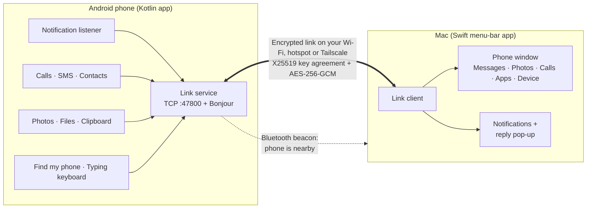
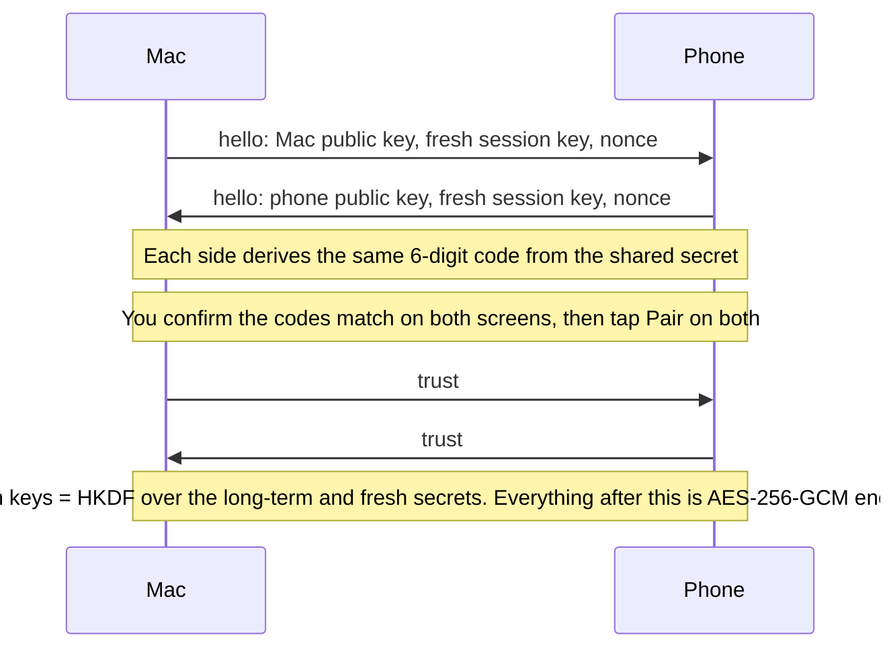

# PhoneBridge

Phone Link–style connection between a Mac and an Android phone: your phone's notifications, calls, messages, photos, clipboard and files on the Mac, with no PhoneBridge servers and no account. Nothing it does goes through the internet.

Developed and tested on a MacBook Air (macOS 27) with a Samsung Galaxy phone (One UI 8, Android 16). Open source under the MIT license.

| Folder | What |
|---|---|
| `mac/` | Menu-bar app (Swift, builds without Xcode) → `mac/build/PhoneBridge.app` |
| `android/` | Companion app (Kotlin) → `PhoneBridge.apk` (release build, signed with the same key every time so updates install over the old one) |

## Features
- 🔔 Phone notifications on the Mac — reply inline (a corner pop-up with a ready text box for chat apps), dismissing on one side dismisses on the other
- 📞 Incoming calls with contact name — **Answer** / **Decline** from the Mac; during a call, a card with the time talked, **Mute**, **Speaker** and **End** (voice stays on the phone)
- 💬 Messages, 📷 photos and videos (with drag-and-drop to Finder), 📋 clipboard (Mac → phone automatic; phone → Mac via the quick-settings tile or **Share → Send to Mac**), 📁 files both ways
- 🎵 Now playing both ways, 🔊 ring your phone, 🔋 battery with time-to-full, 📍 find my phone, 🔦 flashlight and ringer controls
- 📝 A notepad shared between the phone and the Mac, ⌘K search across everything on the phone
- ⌨️ Type on the Mac into the phone's focused text box (select the **PhoneBridge keyboard** on the phone first)
- ✉️ Missed-call auto-reply by SMS ("I'm busy, I'll call you back"), done by the phone itself
- 🎨 **Themes**: a minimal dark look with a floating dock, and six themes to pick from (Midnight, Batman, Spider-Man, Iron Man, Thor, Matrix), each with its own artwork and animation (bats flapping across, a spider on its thread, a pulsing arc reactor, lightning, falling code) plus a short burst when you pick it. The theme is shared: pick it on the phone and the Mac (and its menu bar icon) switch too, and the other way round. The home screen has an animated banner per theme (Spider-Man swinging across between buildings, Iron Man flying with a reactor beam, Thor catching his hammer, the Bat-signal and the Batmobile, a Midnight bridge with data packets, Matrix code rain). Buttons puff out a small themed effect and tick on press, changing tabs plays a themed flourish, and picking a theme, opening the app and connecting each play that theme's character sequence (Thor drops in with lightning, looks up and leaps off; Spider-Man swings in, lands, looks up and swings away; Iron Man lands, looks up, fires missiles and flies off; Batman brings the signal, bats and the Batmobile; Matrix rains code; Midnight draws a constellation bridge). The long settings live in Settings. Phone: Themes tab. Mac: Settings → Appearance.
- 🔒 **Lock when you walk away**: when the phone's Bluetooth beacon fades and the Mac has been idle for a bit, the Mac locks; when the phone comes back, the screen wakes. Switch it off or change the distance in the menu.

## How it works



The phone listens on TCP port 47800 and advertises itself via Bonjour (`_phonebridge._tcp`). The Mac tries, in turn: Bonjour, the last address that worked, the default gateway (= the phone when the Mac is on its hotspot), and the phone's Tailscale address if you use Tailscale. Everything the two apps exchange goes over that one encrypted connection.

### Pairing and the encrypted link



## Quick start

### What you need
- **Mac:** macOS 15 or later (the app's declared minimum; developed on 27) with the Xcode Command Line Tools (`xcode-select --install`). Full Xcode is not needed.
- **Phone:** Android 13 or later.
- **To build the phone app:** Android Studio (its bundled JDK and the Android SDK).
- Both on the same Wi-Fi network (a phone hotspot also works).

### 1. Build and launch the Mac app
```bash
git clone https://github.com/Abhinavchitturi/PhoneBridge.git
cd PhoneBridge/mac
./make-cert.sh   # optional, once: a local signing identity so macOS keeps your permissions across rebuilds
./build.sh
open build/PhoneBridge.app
```
- PhoneBridge lives in the **menu bar** (top right of the screen). It has no Dock icon until one of its windows is open, and closing the windows keeps it running.
- On first launch, allow **Notifications** and **Local Network** when macOS asks. Later features ask for **Accessibility** (media keys, trackpad), **Bluetooth** (lock when you walk away) only when you turn them on.
- Click the menu-bar icon → **Messages, Photos & Calls…** to open the main phone window. Drag `PhoneBridge.app` into `/Applications` to keep it; it can start at login.

### 2. Build and install the phone app
```bash
cd android
JAVA_HOME="/Applications/Android Studio.app/Contents/jbr/Contents/Home" ./gradlew assembleRelease
# the APK is at app/build/outputs/apk/release/app-release.apk (a prebuilt copy sits in the project root as PhoneBridge.apk)
adb install -r app/build/outputs/apk/release/app-release.apk   # or send the file to the phone and open it
```
Samsung phones: **Settings → Security and privacy → Auto Blocker → Off** only while installing; you can turn it back on afterwards and the app keeps working.

Google Play Protect may warn about an app installed outside the Play Store. Tap **Install anyway** (the plain text, not the blue OK button).

### 3. Set up the phone app
Open **PhoneBridge** on the phone. The setup card has a button for each permission:
1. Allow **Calls**, **SMS**, **Notifications** and **Photos**.
2. Allow **notification access**.
3. Optional, for typing from the Mac: switch on **PhoneBridge keyboard** (the **Type from Mac** tile opens the right settings page), then pick it as the keyboard when you want to type.
4. Let it **run in the background** (Samsung: also **Settings → Battery → Background usage limits → Never sleeping apps → add PhoneBridge**).

If Android says *"App was denied access"* or a switch is greyed out, read the next section.

### 4. Pair
On first launch both apps show a radar screen while they look for each other on the same Wi-Fi.

1. Make sure PhoneBridge is open on both devices (same network).
2. Both show a 6-digit code. If they match, tap **Pair** on both. That's the only time you do this.

## Command line and Shortcuts

While PhoneBridge is running it keeps a small tool at `~/.phonebridge/pb`. It talks to the app over a private socket (`~/.phonebridge/pb.sock`, readable only by you), so it works from Terminal, scripts, and the Shortcuts app (add a **Run Shell Script** action and call it).

```sh
~/.phonebridge/pb send report.pdf photo.jpg   # send files to the phone
~/.phonebridge/pb ring            # ring the phone ("pb ring off" to stop)
~/.phonebridge/pb clip "text"     # put text on the phone's clipboard (or: pbpaste | pb clip)
~/.phonebridge/pb status          # prints "connected" / "not connected"; exit code 0 / 1
```

Exit codes: 0 done, 1 failed (e.g. phone not connected), 2 wrong usage, 3 PhoneBridge isn't running. For a shorter command, `sudo ln -sf ~/.phonebridge/pb /usr/local/bin/pb`.

## Allowing SMS, calls and notifications on Android ("restricted settings")

Recent Android versions (13 and later, and stricter with each release) block certain permissions — such as **SMS, call log and notification access** — for any app you install yourself (an APK that didn't come from the Play Store). This is an Android safeguard against malware, so the permission buttons can look disabled or say *"App was denied access"*. It isn't a bug, and it isn't root: you just have to tell Android that you trust this app.

1. Open **Settings → Apps → PhoneBridge**.
2. Tap **⋮** (top right) → **Allow restricted settings**. (If you don't see ⋮, first try to grant the permission once so Android registers the block, then come back.)
3. Go back to PhoneBridge and tap the permission button again. SMS, calls and notification access can now be granted normally.

PhoneBridge needs these permissions for exactly what it says: reading and sending SMS for the Messages tab and the missed-call auto-reply; the call log, contacts and phone state to show who's calling; notification access to mirror and reply to notifications. See the next section for what happens to that data.

## Security and privacy

PhoneBridge is designed so your data never leaves your own devices:

- **No account, no cloud, no analytics, no ads.** Notifications, messages, photos, clipboard and files travel directly between your phone and your Mac. There are no PhoneBridge servers.
- **End-to-end encrypted.** After pairing, everything is encrypted with AES-256-GCM using keys from an X25519 key agreement. Each connection also uses fresh keys, so a stolen long-term key can't decrypt past sessions (forward secrecy).
- **Pairing is verified by you.** The 6-digit code on both screens guards against someone else connecting between your devices. After pairing, the Mac only talks to your phone and the phone only to your Mac, and each refuses other devices.
- **Keys stay put.** On the Mac they're in the Keychain; on the phone they're sealed with a key in the Android Keystore (hardware-backed where available).
- **It's open source.** The protocol is in `mac/Sources/Crypto.swift` and `android/app/src/main/java/app/phonebridge/Crypto.kt`, with unit tests that check both sides produce identical keys and codes. Read it, audit it, and please report anything wrong.
- **Nothing goes over the internet.** The phone and the Mac only talk to each other, directly.
- **One third-party component:** the "scan a document to the Mac" feature uses Google's on-device document scanner from Google Play Services.

What this is **not**: it has not had an independent security audit, and it can't protect you if the phone or the Mac itself is already compromised. Locking the Mac when you walk away is a convenience, not a vault — someone who reaches the Mac before it locks, or boots it into Recovery, can still get in, so also use FileVault and Find My. If you find a security problem, see [SECURITY.md](SECURITY.md).

## License

MIT — see [LICENSE](LICENSE).
