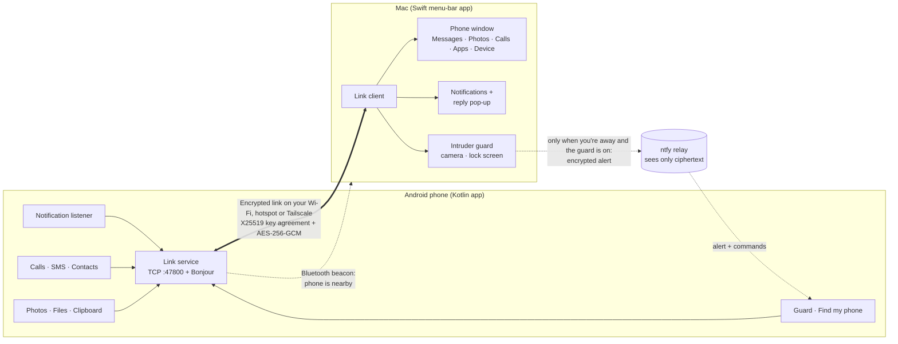
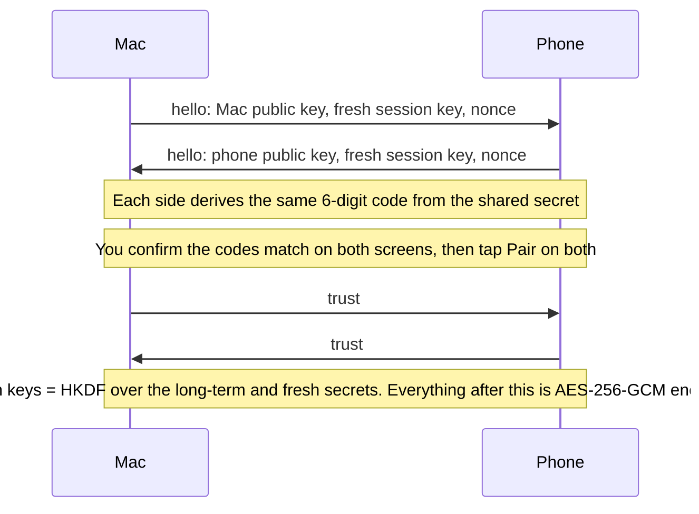
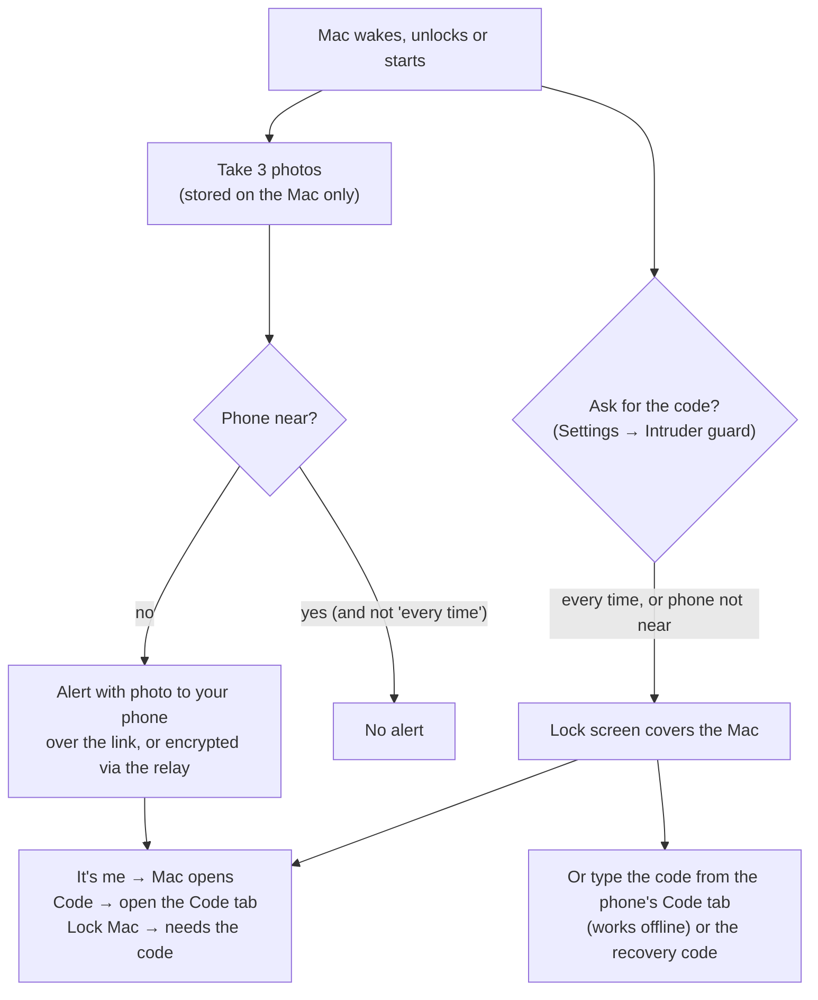

# PhoneBridge

Phone Link–style connection between a Mac and an Android phone: your phone's notifications, calls, messages, photos, clipboard and files on the Mac, with no PhoneBridge servers and no account. (The only internet traffic is an optional, encrypted relay for the intruder guard — see Security and privacy.)

Developed and tested on a MacBook Air (macOS 27) with a Samsung Galaxy phone (One UI 8, Android 16). Open source under the MIT license.

| Folder | What |
|---|---|
| `mac/` | Menu-bar app (Swift, builds without Xcode) → `mac/build/PhoneBridge.app` |
| `android/` | Companion app (Kotlin) → `android/app/build/outputs/apk/debug/app-debug.apk` |

## Features
- 🔔 Phone notifications on the Mac — reply inline (a corner pop-up with a ready text box for chat apps), dismissing on one side dismisses on the other
- 📞 Incoming calls with contact name — **Answer** / **Decline** from the Mac; during a call, a card with the time talked, **Mute**, **Speaker**, **Hold** and **End** (voice stays on the phone)
- 💬 Messages, 📷 photos and videos (with drag-and-drop to Finder), 📋 clipboard (Mac → phone automatic; phone → Mac via the quick-settings tile or **Share → Send to Mac**), 📁 files both ways
- 🎵 Now playing both ways, 🔊 ring your phone, 🔋 battery with time-to-full, 📍 find my phone, 🔦 flashlight and ringer controls, 🔒 lock the phone from the Mac, or unlock it (wakes it and taps your PIN; PIN-style locks only)
- 📝 A notepad shared between the phone and the Mac, ⌘K search across everything on the phone
- ✉️ Missed-call auto-reply by SMS ("I'm busy, I'll call you back"), done by the phone itself
- 🛡️ **Intruder guard** (off by default, Settings → Intruder guard): takes a few photos when the Mac wakes, unlocks or starts (kept only on the Mac and deleted at the end of each day; the phone just shows them and stores nothing), and — if your phone isn't near — sends them to your phone with **It's me** / **Lock Mac** buttons, over the paired link or (when the Mac is elsewhere) through an end-to-end encrypted relay. The Mac can also lock itself after sleep, restart or startup (every time, or only when your phone isn't near); the phone alert then has **It's me** (opens the lock) and **Code** buttons. **Lock Mac** puts a full-screen lock on the Mac that only opens with a rolling authenticator code from the phone (works offline, also works in Google/Microsoft Authenticator) or a one-time recovery code. It deters and alerts; it cannot stop someone who holds the power button or boots into Recovery, so also use FileVault and Find My.

## How it works



The phone listens on TCP port 47800 and advertises itself via Bonjour (`_phonebridge._tcp`). The Mac tries, in turn: Bonjour, the last address that worked, the default gateway (= the phone when the Mac is on its hotspot), and the phone's Tailscale address if you use Tailscale. Everything the two apps exchange goes over that one encrypted connection. The only thing that can touch the internet is the optional guard relay, described below.

### Pairing and the encrypted link



### Intruder guard flow



## Quick start

### What you need
- **Mac:** macOS 15 or later (the app's declared minimum; developed on 27) with the Xcode Command Line Tools (`xcode-select --install`). Full Xcode is not needed.
- **Phone:** Android 13 or later.
- **To build the phone app:** Android Studio (its bundled JDK and the Android SDK).
- Both on the same Wi-Fi network (a phone hotspot also works).

### 1. Build and launch the Mac app
```bash
git clone https://github.com/Abhinavchitturi/PhoneBridge.git
cd PhoneBridge/mac
./make-cert.sh   # optional, once: a local signing identity so macOS keeps your permissions across rebuilds
./build.sh
open build/PhoneBridge.app
```
- PhoneBridge lives in the **menu bar** (top right of the screen). It has no Dock icon until one of its windows is open, and closing the windows keeps it running.
- On first launch, allow **Notifications** and **Local Network** when macOS asks. Later features ask for **Accessibility** (media keys, trackpad), **Bluetooth** (lock when you walk away) and **Camera** (intruder guard) only when you turn them on.
- Click the menu-bar icon → **Messages, Photos & Calls…** to open the main phone window. Drag `PhoneBridge.app` into `/Applications` to keep it; it can start at login.

### 2. Build and install the phone app
```bash
cd android
JAVA_HOME="/Applications/Android Studio.app/Contents/jbr/Contents/Home" ./gradlew assembleDebug
# the APK is at app/build/outputs/apk/debug/app-debug.apk
adb install -r app/build/outputs/apk/debug/app-debug.apk   # or send the file to the phone and open it
```
Samsung phones: **Settings → Security and privacy → Auto Blocker → Off** only while installing; you can turn it back on afterwards and the app keeps working.

### 3. Set up the phone app
Open **PhoneBridge** on the phone. The setup card has a button for each permission:
1. Allow **Calls**, **SMS**, **Notifications** and **Photos**.
2. Allow **notification access**.
3. Let it **run in the background** (Samsung: also **Settings → Battery → Background usage limits → Never sleeping apps → add PhoneBridge**).

If Android says *"App was denied access"* or a switch is greyed out, read the next section.

### 4. Pair
1. Make sure PhoneBridge is open on both devices (same network).
2. Both show a 6-digit code. If they match, tap **Pair** on both. That's the only time you do this.

## Allowing SMS, calls and notifications on Android ("restricted settings")

Recent Android versions (13 and later, and stricter with each release) block certain permissions — such as **SMS, call log and notification access** — for any app you install yourself (an APK that didn't come from the Play Store). This is an Android safeguard against malware, so the permission buttons can look disabled or say *"App was denied access"*. It isn't a bug, and it isn't root: you just have to tell Android that you trust this app.

1. Open **Settings → Apps → PhoneBridge**.
2. Tap **⋮** (top right) → **Allow restricted settings**. (If you don't see ⋮, first try to grant the permission once so Android registers the block, then come back.)
3. Go back to PhoneBridge and tap the permission button again. SMS, calls and notification access can now be granted normally.

PhoneBridge needs these permissions for exactly what it says: reading and sending SMS for the Messages tab and the missed-call auto-reply; the call log, contacts and phone state to show who's calling; notification access to mirror and reply to notifications. See the next section for what happens to that data.

## Security and privacy

PhoneBridge is designed so your data never leaves your own devices:

- **No account, no cloud, no analytics, no ads.** Notifications, messages, photos, clipboard and files travel directly between your phone and your Mac. There are no PhoneBridge servers.
- **End-to-end encrypted.** After pairing, everything is encrypted with AES-256-GCM using keys from an X25519 key agreement. Each connection also uses fresh keys, so a stolen long-term key can't decrypt past sessions (forward secrecy).
- **Pairing is verified by you.** The 6-digit code on both screens guards against someone else connecting between your devices. After pairing, the Mac only talks to your phone and the phone only to your Mac, and each refuses other devices.
- **Keys stay put.** On the Mac they're in the Keychain; on the phone they're sealed with a key in the Android Keystore (hardware-backed where available).
- **It's open source.** The protocol is in `mac/Sources/Crypto.swift` and `android/app/src/main/java/app/phonebridge/Crypto.kt`, with unit tests that check both sides produce identical keys and codes. Read it, audit it, and please report anything wrong.
- **The only internet traffic is the optional guard relay.** If you switch on the intruder guard and your Mac is away from your phone, the alert is encrypted with a key only your two devices share and sent through a public [ntfy](https://ntfy.sh) server (or one you host), whose address you can change in Settings. The relay topic names are random and unguessable, and the commands your phone sends back are signed, so nobody else can lock your Mac. The server can still see that messages exist, their size and timing, and your IP address, but not their contents. Guard photos are stored on the Mac only and deleted at the end of each day.
- **One third-party component:** the "scan a document to the Mac" feature uses Google's on-device document scanner from Google Play Services.

What this is **not**: it has not had an independent security audit, and it can't protect you if the phone or the Mac itself is already compromised. The intruder guard is a deterrent and an alarm, not a vault — someone holding the power button or booting into Recovery can still get around it, so also use FileVault and Find My. If you find a security problem, see [SECURITY.md](SECURITY.md).

## License

MIT — see [LICENSE](LICENSE).
